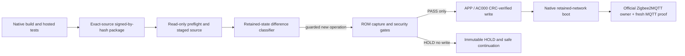

# P7U official-owner operator: reliability contract

This is the **generic** live-update operator for the SLZB-06P7U/CC2652P7, not a one-off V57 recovery script. The goal is to make a protected firmware update *predictable* without weakening retained Zigbee network or cryptographic state.

## Lessons from the 13 November 2026 V57 security HOLD

The one-shot operation `2d087028` reached the read-only ROM capture and returned `P7U_DEPLOY_HOLD_NATIVE_SECURITY` **before any verified APP write or boot**. It had correct network identity, live counter floors and APS tail but observed legitimate runtime differences since V56's baseline: short-address reassignment; a released association; two explicitly acknowledged new peers; one all-FF retirement of a vacant address slot; a few trust-centre rejoin epochs; and an existing verified trust-centre peer moving to a different **TC storage slot**. Blind retries of the consumed operation are not supported.

### Improved generic admission

The offline native-security gate now recognizes only these precisely classified cases:

| Pattern | Admission | Refused when |
|---|---|---|
| Zigbee short-address reassignment on same IEEE and storage slot | Existing bounded normalization | Any other byte changes |
| Association release while retaining SECURITY | Existing behavior | Added association without explicit `ASSOC_GAIN` |
| Persisted vacancy → fully `0xFF` TI sentinel | Only if unreferenced by APS and the old row was known empty | Partly filled, live EUI, or APS reference |
| New address + new trust-centre peer | Explicit **per-IEEE `NEW_PEER`**, unique current secure address, no missing earlier peer | Occupied-row replacement, unacknowledged EUI, missing secure address |
| Verified link-key re-derivation | Explicit **`KEY_REROLL`**, unchanged seed, key type, attributes, install-code metadata | Different security attributes or key material |
| TI verified → default fresh rejoin | Explicit **`FRESH_REJOIN`** | Rejoin representation inconsistent with TI |
| Default → default new derived-key epoch | Explicit **`TC_DEFAULT_EPOCH`**, changed seed shift only | Unchanged epoch and regressed counters, altered type or attributes |
| Existing TC entry moved to another storage slot | Explicit **`TC_RELOCATE`** for that EUI, plus a second appropriate epoch acknowledgement if key epoch changed | Any peer deleted, unexpected key fields or replay regressions in an unchanged epoch |

**TC slot movement is not a new Zigbee identity or a new network key**. It is still owner-scoped because physical table movement must not be mistaken for a valid rejoin automatically. An acknowledgement is a field-specific permission, not an unconditional bypass. All exact-source, coordinator identity, NV layout, flash sectors, security-key epoch and monotonically safe NWK/APS replay-floor guards remain in force.

### Deterministic operation and safe continuation

- The runner's `preflight` and `prepare` identify native/package SHA and the single official Zigbee2MQTT UART owner; `READY_WITH_WARNINGS` explicitly distinguishes preflight readiness from a *fresh NV semantic pass*. A fresh ROM-backed NV read cannot be invented while Z2M owns the UART.
- The read-only diff prints `NO_FRESH_NV_CAPTURE` when there is no matching captured operation, rather than crashing from `max()` on an empty list.
- `--on-hold preserve` on `flash` leaves a **zero-write** security HOLD in place for the existing immutable continuation, and does not attempt a radio reset or pretend a flash succeeded. The default remains best-effort restore of unchanged service.
- `button.slzb_06p7u_zigbee_restart` commonly has HA state `unknown` before being pressed; that state **does not** mean the entity is unavailable. Restart admission now checks existence, attributes and explicit `unavailable`, with all action errors still propagated.
- A continuation is **not a retry**: create a new delivery workdir, fetch a newly source-pinned operator package with the same V57 native image, stage with `--continue-hold <prior operation>`, obtain a fresh plan, then invoke one new operator action. It independently verifies the old HOLD's file set, journal, 88 sparse ROM CRCs, captured NV and unchanged owner before it may reuse the still-open BSL session.
- When a transfer result is ambiguous, inspect `status`; never replay consumed execute/BSL/write/boot commands.
- No broad erase, security-counter inflation, identity cloning, new PAN or device re-pairing is part of this feature.

## Physical outcome and follow-up

The corrected admission predicted **PASS** from the immutable 13 November NV capture. The staged continuation produced a fresh operation whose APP+AC000 CRC/88 ROM CRC verification, state9 boot, 3-device serving proof and live B1E8 evidence all passed. The official owner and HA automations were restored to normal operation **without any intermediate V56 or stock reflash**. See [V57 status](../coordinators/slzb-06p7u/STATUS_2026-11-13.md). Later cold starts are still required to confirm the V57 parser hypothesis.

## Operator-only release checklist

1. Add synthetic tests for each newly admitted transition *and* its malicious or inconsistent variant.
2. Keep the **firmware SHA, native run and candidate artifact identical**; change only the operator package and associated source/test files.
3. Pass GitHub-hosted operator/retained-state tests; package with exact per-IEEE acknowledgements and official Zigbee2MQTT mode.
4. Fetch and verify all new operator hashes; use the read-only captured evidence to predict the fresh security verdict.
5. Stage a continuation against the immutable zero-write HOLD. Prepare a **new operation ID**.
6. Deploy once. Require verified APP+AC000 write, all 88 ROM CRCs, native boot, source digest, state 9 and fresh non-retained traffic from multiple devices before reporting success.
7. Record any later morning cold-start RX resync evidence separately: V57's parser root-cause hypothesis is still a hypothesis until physical evidence supports it.

## Architecture and ownership

The official Zigbee2MQTT app owns the USB endpoint except during the sealed operator window. CI never touches the live coordinator. Vendor SMLIGHT management commands must stay source-version-verified and identity-bound.
