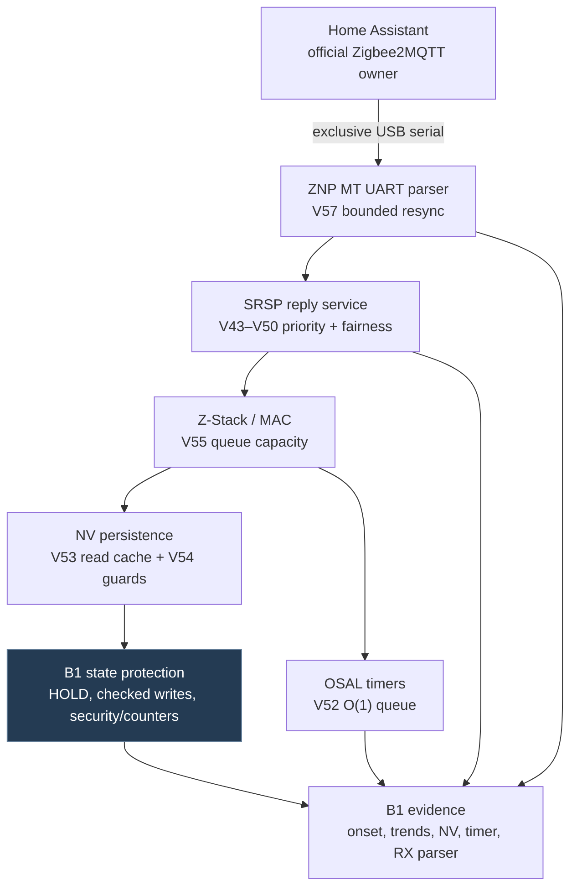

# R4 on SLZB-06P7U: what changed compared with stock ZNP

> **Scope:** SMLIGHT **SLZB-06P7U R1.73** with TI **CC2652P7**, not MR4U/P10 or SONOFF/MG24. R4 is a source-modified, stock-derived Z-Stack ZNP for this particular board and Zigbee2MQTT installation. This is a **technical feature comparison**, not a vendor-certified head-to-head benchmark or a promise of zero future hangs. **V57 was physically installed 13 November 2026;** first-serving proof and the first observed 14 November morning startup passed. Extended/cold-start acceptance remains open.

[Project home](../README.md) · [P7U implementation](../coordinators/slzb-06p7u/README.md) · [Release notes](../coordinators/slzb-06p7u/RELEASE_NOTES.md) · [Delivery procedure](../coordinators/slzb-06p7u/OFFICIAL_OWNER_DELIVERY.md) · [14 Nov live field evidence](../coordinators/slzb-06p7u/STATUS_2026-11-14.md)

## Why this fork exists

On a dense, roughly 100+ node network, loss of ZNP/SRSP responsiveness was a *real operational failure*, not just a slow interview. The R4 project tackles the actual firmware and transport behavior—serial framing, task scheduling, NV work, timers and internal visibility—rather than treating a power cycle or image rollback as a fix. Existing Zigbee identity and security state remain preserved.

### Reliability architecture

*Diagram shows logical concerns, not necessarily literal call order or isolated execution threads.*

## Feature-by-feature differences

| Layer / release | Reference TI/vendor ZNP behavior | R4 change | Why it matters |
|---|---|---|---|
| **B0 — board contract** | Hardware-specific ZNP builds must match board pins and radio | Explicit CC2652P7 DIO12/DIO13, 115200 UART, no RTS/CTS; native build and provenance record | Avoids importing incompatible donor-board assumptions |
| **B1 — NV fail-closed** | Standard NV persistence and startup path | Checked writes/read-back; sticky, queryable HOLD on inconsistency; boot admission | Corruption or incomplete restore is refused instead of silently forming a different network |
| **B1 — identity/security** | Stock Z-Stack network management | Preserved PAN/extPAN, IEEE, keys, TCLK/APS tables and reserved monotonic frame counters; restored BDB startup | Protects the existing joined mesh across firmware changes |
| **V43 — UART TX** | Stock NPI write path | Rejected UART writes cannot strand the NPI task indefinitely | Removes one identified wait-forever class |
| **V44–V46 — replies** | Standard task/queue scheduling | Reserved SRSP service capacity and bounded priority servicing | Prevents replies from being perpetually displaced by busy stack work |
| **V47–V50 — startup/fairness** | Stock ZDApp start and task priorities | Startup ingress fairness; sticky NPI priority floor, bounded stack-service aging | Improves coordinator responsiveness under load, without simply starving other tasks |
| **V51 — diagnosis** | Limited project-specific visibility | Onset capture, long-dispatch and heap reports, 5/60-minute trend rings | Distinguishes saturation, deadlocks and resource pressure from host symptoms |
| **V52 — timers** | Existing OSAL timer free/dispatch | Expired timer cleanup; O(1) enqueue; diagnostic page | Reduces timer bookkeeping overhead and offers direct failure evidence |
| **V53 — NV reads** | Repeated NV reads under heavy traffic | Guarded in-memory NV read cache with per-item cost counters | **Fixes the previously observed NV read storm**, the central R4 hang investigation finding |
| **V54 — cache safety** | No R4 cache | No cache hit/insert during HOLD; TCLK seed not cached; null/empty reads bypass | Keeps the optimization from hiding invalid state or retaining sensitive key material |
| **V55 — MAC capacity** | TI reference queue sizes 5 / 8 / 5 | Queue sizes 50 / 80 / 50 | Adds headroom for the dense network; requires monitoring RAM and drops |
| **V57 — MT RX parser** | Partial MT frame can wait indefinitely after stray `0xFE`; accepts oversized length field | Resync after a measured idle gap, reject lengths above 250, B1E8 discarded-byte evidence | **Targets intermittent cold-start failure** without assuming the observed cause is already proved |

**Important distinction:** V55/V56 included a device-specific dimmer experiment that did not repair the device; **V57 removes those special cases** and returns that security behavior to TI's baseline. This fork does **not** bypass Zigbee trust-center security to force a device online.

## The critical reliability fix: V53 stopped repeated NV reads

Under heavy traffic, Z-Stack repeatedly performed expensive persistent-NV reads (a **read storm**) on the frame-handling hot path. V53 added a bounded, guarded, invalidation-aware in-RAM read cache; V54 closes the HOLD and sensitive-seed safety gaps. This is a **source-level mechanism correction**, not a queue-size increase that merely postpones overload.

**Physical confirmation:** V56 measured **99.92%** NV cache hits; V57 on 14 November measured **2,514,627 hits / 2,798 misses (99.89%)** across 1,177,678 MAC data indications, with 3.5% average stack busy and no sampled saturation. The new NV cache does not prove all future stalls impossible; it **directly addresses the previously identified NV storm**, which makes it the strongest evidence-backed improvement over the older firmware path in this installation. [Deep V53 review](../coordinators/slzb-06p7u/REVIEW_V53_2026-10-31.md).

## Measurement, not marketing

The 11 November 2026 V56 live evidence recorded:

| Metric | Observation | Meaning |
|---|---:|---|
| Runtime | 10 h 37 min | One inspected session, not a lifetime reliability guarantee |
| Stack busy | 2.5% | No sampled saturation in that session |
| NV cache hits | **99.92%** | Strong evidence that repetitive NV reads were eliminated in that workload |
| MAC request refusals | **0 / 91,708** | No observed MAC queue refusals in this sample |
| NV failures / HOLD | 0 / 0 | No failure reported by the queried pages |

Those figures are from R4 **V56**, *not* a controlled same-hardware stock-versus-R4 trial. They support a major improvement in this installation but do not establish that every possible ZNP hang has been eliminated.

**New V57 physical data, 14 November:** verified single host startup (06:09:17 → 06:09:39 Prague) with no rejected first SYS_PING attempts in the inspected startup; **6 h 12 min** uptime, **32,087 valid MT frames**, **zero FCS errors**, **five runtime resyncs** and **363 discarded bytes**. The first resync occurred about five hours into the runtime, *not at boot*. First-day success narrows but does not close the previous intermittent cold-start fault. MAC request admission was **0 / 79,752 refused**, while **9,320 MAC confirmations failed** (~11.7%) and device-level route/ZCL errors persist. Read the [detailed field audit](../coordinators/slzb-06p7u/STATUS_2026-11-14.md).

## Diagnostics: why R4 is easier to investigate

- **Observable safety state:** B1S1/B1N1 stay available in HOLD, while unsafe commands are rejected.
- **Evidence pages:** B1E1–B1E7 expose startup, CPU/MAC work, heap/onset, trends, timer costs and NV cache behavior; V57 adds **B1E8** for MT parser validity, gap resync, rejected lengths and first discarded bytes.
- **Live read without Zigbee outage:** `tools/p7u_live_evidence.py` through the official Zigbee2MQTT integration, when supported by the installed firmware.
- **Incident capture:** the separate hang runbook records proof before any reset can destroy volatile data.
- **Persistent engineering provenance:** exact source SHA, native CI run, operator package hash, protected flash operation and post-boot receipt.

## Deployment engineering beyond the stock binary

The repo ships a dedicated **guarded delivery pipeline** rather than asking an operator to blindly upload a BIN:

1. Native GitHub Actions build, integration tests and per-source qualification/pinning.
2. Package verification and preflight against actual owner, USB port, SLZB hardware, NV headroom and backup.
3. Pre-write comparison of retained identity/security/network state, with exact EUI-scoped owner acknowledgements for legitimate changes.
4. Exclusive serial owner during flash; one protected APP plus AC000 operation. No broad NV erase, unrequested re-pairing or cloned coordinator identity.
5. Read-back CRC, native boot, verified Zigbee2MQTT startup and fresh device traffic. Ambiguous writes are **never** automatically retried.
6. Zero-write HOLD can restore service to the *unchanged* firmware; post-write failures require explicit investigation.

GitHub Actions do **not** directly flash the household coordinator. The actual operation is initiated on an authorized machine using [the delivery runner](../coordinators/slzb-06p7u/OFFICIAL_OWNER_DELIVERY.md).

## What R4 does *not* claim

- No universal proof of stability or zero hangs across all workloads, devices or mornings.
- No proven source-equivalence or independently verified superiority over every released SMLIGHT/TI firmware image.
- No authority to skip security-counter, NV, power, serial ownership or rollback gates.
- No claim that Zigbee routing, RF conditions, interference or every end-device problem is fixed by coordinator firmware.
- No device-specific workaround accepted without generalizable evidence and safety review.

## Source map

| Concern | Implementation / evidence |
|---|---|
| Firmware composition | [R4 composite stage](../tools/r4_b0_b4_composite_stage.py) |
| Scheduling, NV cache and telemetry | [V50–V54 stage](../tools/r4_v50_stack_service.py) |
| Timer implementation | [V52 stage](../tools/r4_v52_osal_timers.py) |
| MT RX resync | [V57 stage, source-pinned](https://github.com/analienx/Zigbee-Coordinator/blob/eb59b6773dd0fe328c1194647c00e8a070d18a22/tools/r4_v57_npi_rx_resync.py) |
| B1 protected NV | [B1 source tree](../firmware/slzb-06p7u/r4/b1/) |
| Official-owner flashing | [Delivery tool](../tools/p7u_official_delivery.py) |
| Native validation | [Native workflow](../.github/workflows/test-r4-stock20260311-native.yml) |
| Physical events | [P7U release notes](../coordinators/slzb-06p7u/RELEASE_NOTES.md) |

**Maintenance rule:** update the evidence row and installed-version status after *physical verification*, not merely after a successful build or a newly pushed commit.
